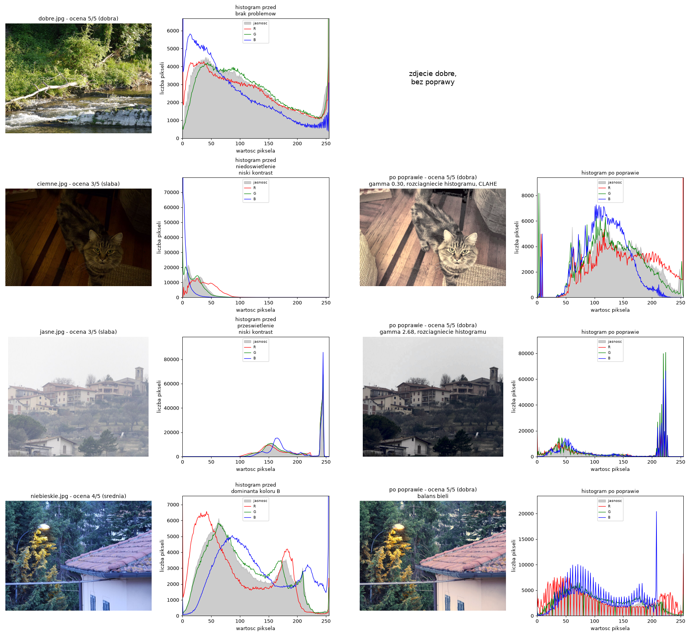

# Zadanie 2 - automatyczna analiza jakości zdjęć na podstawie histogramu

Skrypt `zad2.py` pobiera kilka zdjęć z Wikimedia Commons, liczy dla nich histogramy (jasność oraz osobno kanały R, G, B), na podstawie liczb z histogramu ocenia jakość zdjęcia i wypisuje wykryte problemy. Zdjęcia ocenione jako wadliwe są automatycznie poprawiane i oceniane ponownie.

## Uruchomienie

```
pip install -r requirements_zad2.txt
python zad2.py
```

Skrypt można uruchomić z dowolnego katalogu. Przy pierwszym uruchomieniu zdjęcia są pobierane do folderu `zdjecia/` (z nagłówkiem `User-Agent`, bez niego Wikimedia zwraca błąd 403), przy kolejnych są wczytywane z dysku.

## Jak działa ocena

Dla każdego zdjęcia liczony jest histogram jasności (grayscale) i histogramy kanałów R, G, B. Z histogramu wyliczane są: średnia, odchylenie standardowe, percentyle 1% i 99% oraz udział pikseli prawie czarnych (<= 10) i prawie białych (>= 245). Progi są stałymi na początku pliku.

Wykrywane problemy:

- **niedoświetlenie** - średnia jasność poniżej 70 albo ponad 10% pikseli prawie czarnych,
- **prześwietlenie** - średnia jasność powyżej 185 albo ponad 10% pikseli prawie białych (clipping),
- **niski kontrast** - odchylenie standardowe poniżej 40 albo zakres między percentylem 1% i 99% węższy niż 150,
- **dominanta koloru** - różnica między największą i najmniejszą średnią kanałów R, G, B większa niż 40.

Ocena w skali 1-5: zdjęcie bez problemów dostaje 5, każdy wykryty problem odejmuje jeden punkt (5 - dobra, 4 - średnia, 3 i mniej - słaba).

## Poprawa zdjęć (bonus)

Korekcja jasności i kontrastu jest robiona tylko na kanale L w przestrzeni Lab, żeby nie przesuwać kolorów:

- niedoświetlenie / prześwietlenie - korekcja gamma dobrana tak, żeby średnia jasność wyszła około 128,
- niski kontrast - rozciągnięcie histogramu (zakres percentyli 1-99 na 0-255; przy prześwietleniu górna granica zostaje na 255, żeby nie zwiększać obszaru białego),
- niedoświetlenie - dodatkowo CLAHE (lokalne wyrównanie histogramu),
- dominanta koloru - balans bieli metodą gray world; dominanta jest sprawdzana na końcu, już po korekcji jasności.

## Zdjęcia testowe

Wszystkie z Wikimedia Commons, w wersji o szerokości 960 px:

| plik | zdjęcie na Commons | typ |
|---|---|---|
| `dobre.jpg` | [Normal_exposure_photography.JPG](https://commons.wikimedia.org/wiki/File:Normal_exposure_photography.JPG) | poprawnie naświetlone |
| `ciemne.jpg` | [Underexposed_cat.jpg](https://commons.wikimedia.org/wiki/File:Underexposed_cat.jpg) | niedoświetlone |
| `jasne.jpg` | [Overexposed_photo.JPG](https://commons.wikimedia.org/wiki/File:Overexposed_photo.JPG) | prześwietlone |
| `niebieskie.jpg` | [Cold_color_temperature.JPG](https://commons.wikimedia.org/wiki/File:Cold_color_temperature.JPG) | niebieska dominanta (zła temperatura barwowa) |

Adresy plików są wpisane w liście `ZDJECIA` w skrypcie. Są to adresy z serwera `thumb.wikimedia.org`, bo `upload.wikimedia.org` zwracał przy testach błąd 429 (zbyt wiele zapytań).

## Wyniki

| zdjęcie | ocena przed | wykryte problemy | poprawa | ocena po |
|---|---|---|---|---|
| dobre.jpg | 5/5 (dobra) | brak | brak | - |
| ciemne.jpg | 3/5 (słaba) | niedoświetlenie (średnia 23, 24% pikseli prawie czarnych), niski kontrast (odchylenie 15, zakres 1-70) | gamma 0.30, rozciągnięcie histogramu, CLAHE | 5/5 (dobra) |
| jasne.jpg | 3/5 (słaba) | prześwietlenie (średnia 192, 11% pikseli prawie białych), niski kontrast (zakres 115-246) | gamma 2.68, rozciągnięcie histogramu | 5/5 (dobra) |
| niebieskie.jpg | 4/5 (średnia) | dominanta koloru B (średnie R/G/B: 88/104/132) | balans bieli | 5/5 (dobra) |

Zestawienie wszystkich zdjęć z histogramami przed i po poprawie jest w pliku `wynik_zad2.png`:



W folderze `wyniki/` są dodatkowo osobne wykresy dla każdego zdjęcia (zdjęcie, histogram jasności i histogramy R, G, B) przed i po poprawie oraz poprawione zdjęcia.

## Uwagi

- Progi zostały dobrane na tych zdjęciach testowych, na innych zdjęciach mogą wymagać zmiany. Np. zdjęcie nocne albo zdjęcie śniegu zostanie ocenione jako wadliwe, chociaż ciemny lub jasny wygląd jest tam zamierzony.
- Kryterium dominanty koloru jest proste - zdjęcie z dużą ilością zieleni albo nieba też ma różne średnie kanałów, dlatego próg jest dość wysoki (40).
- Na mocno niedoświetlonym zdjęciu kota po rozjaśnieniu widać szum i schodkowy histogram (mało poziomów jasności w oryginale zostało rozciągniętych na cały zakres). Ocena liczbowa jest dobra, ale wizualnie zdjęcie nie jest idealne.
- W prześwietlonym zdjęciu obszary całkowicie białe (niebo) nie odzyskują szczegółów, gamma tylko je przyciemnia.
